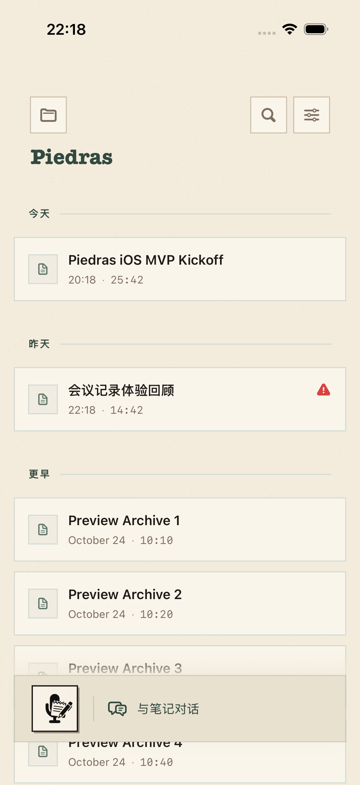
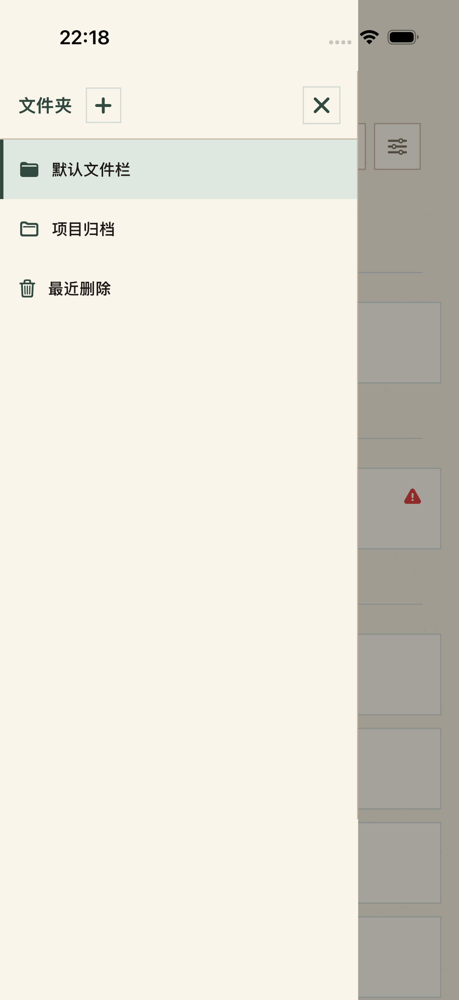
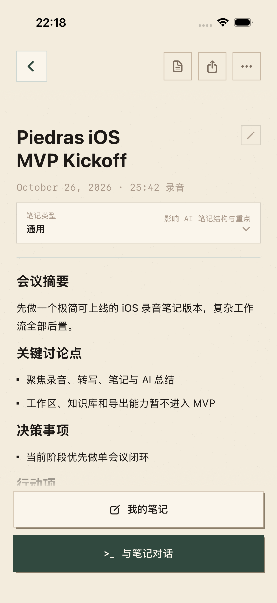
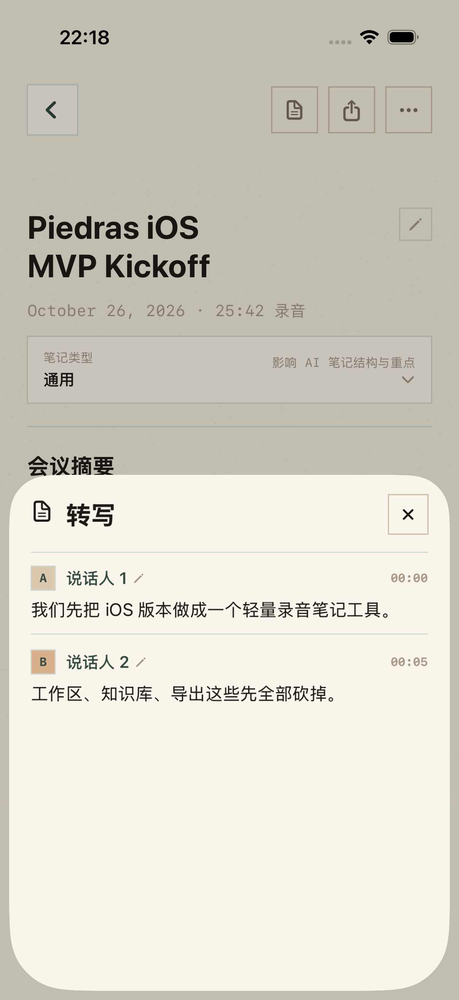
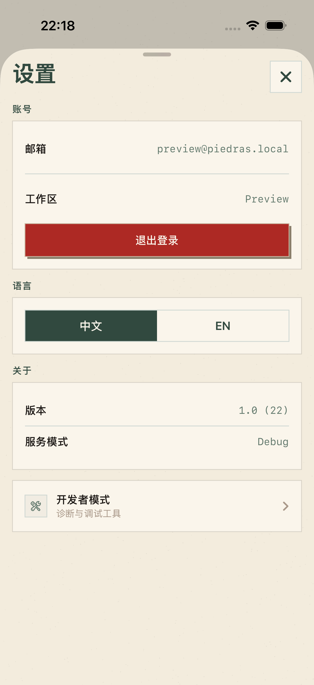
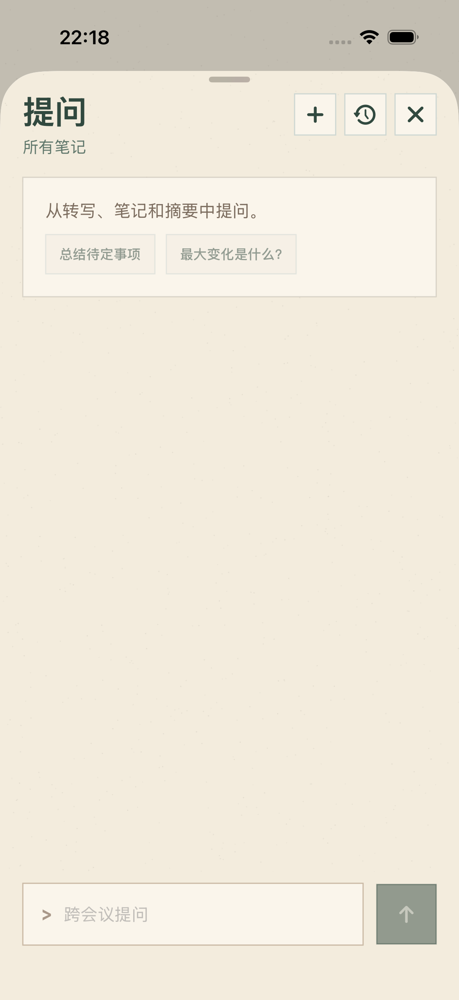

# Piedras iOS

一个以录音、转写与笔记为中心的原生 iOS 产品原型。保留米色纸张、深绿文字、方形控件和硬阴影的视觉语言，用于回看产品方向与继续探索交互设计。

**当前定位：本地演示与设计参考。ASR 和历史云端服务已断开，不能把截图中的转写、摘要或账号状态理解为真实在线服务仍可用。**

当前代码基线为 **2026-04-09 · `043f169`**，包含文件夹、笔记、附件、账号与同步相关实现。Web 原型独立存放在 [ASR-test-webdemo](https://github.com/JzzzX/ASR-test-webdemo)。

## 界面预览

以下为本地 iPhone 17 Pro 模拟器的真实截图，原图 **1206 × 2622**，点击可查看完整尺寸。内容来自仓库内置的 Preview 演示数据，不是实际录音、真实账号或本次 AI 生成结果。截图未修改界面内容。

<table>
  <tr>
    <td align="center"><strong>首页与笔记列表</strong><br><a href="docs/screenshots/01-home.png"></a></td>
    <td align="center"><strong>文件夹抽屉</strong><br><a href="docs/screenshots/02-folders.png"></a></td>
    <td align="center"><strong>笔记详情</strong><br><a href="docs/screenshots/03-note.png"></a></td>
  </tr>
  <tr>
    <td align="center"><strong>转写面板</strong><br><a href="docs/screenshots/04-transcript.png"></a></td>
    <td align="center"><strong>设置</strong><br><a href="docs/screenshots/05-settings.png"></a></td>
    <td align="center"><strong>与笔记对话</strong><br><a href="docs/screenshots/06-chat.png"></a></td>
  </tr>
</table>

## 现在可以看什么

| 范围 | 当前状态 |
| --- | --- |
| 首页、文件夹、笔记详情、转写阅读、设置 | 已用内置 Preview 数据打开并截图 |
| 纸张质感、字体、层级、抽屉与面板交互 | 可作为本地设计参考 |
| 录音与音频管理 | 实现保留；本次没有验证真实录音全流程 |
| 实时 ASR、云端补转写 | 服务已断开，需要重新配置后端与供应商凭据 |
| AI 摘要与问答 | 接口实现保留；截图中的摘要为预置文本，未验证真实模型调用 |
| 登录、云同步与附件上传 | 实现保留；Preview 账号不是云端登录成功的证明 |

本仓库不提供当前可用的在线演示地址。旧文档中的 Vercel、Zeabur 等域名属于历史部署记录。

## 本地打开

需要 macOS、Xcode 和 iOS Simulator。本次使用 iPhone 17 Pro / iOS 26.2 验证。

```bash
git clone https://github.com/JzzzX/piedras-ios.git
cd piedras-ios
open Piedras.xcodeproj
```

在 Xcode 选择 `piedras` Scheme 和 iPhone 模拟器。若只想查看截图里的本地界面，在 **Product → Scheme → Edit Scheme → Run → Arguments** 中添加：

```text
UITEST_IN_MEMORY
UITEST_ISOLATED_DEFAULTS
UITEST_USE_SIMULATOR_BACKEND
```

这些是项目已有的预览/测试参数：使用内存数据和演示账号，重启后演示数据重新生成，不代表生产登录、云同步或 ASR 已恢复。涉及 AI 或网络的操作仍可能需要本地后端；浏览静态演示内容即可查看主要界面。

命令行构建：

```bash
xcodebuild \
  -project Piedras.xcodeproj \
  -scheme piedras \
  -destination 'platform=iOS Simulator,name=iPhone 17 Pro' \
  CODE_SIGNING_ALLOWED=NO build
```

## 代码结构

```text
piedras/                 SwiftUI iOS 客户端
  App/                   应用入口与依赖容器
  Features/              首页、详情、转写、问答、设置等页面
  Stores/                状态与业务协调
  Services/              音频、网络、同步等服务
  Data/                  SwiftData 模型、仓储与适配
  Shared/                主题、组件、工具与多语言文案
piedrasTests/            单元测试
piedrasUITests/          UI 测试
cloud/api/               历史 Next.js + Prisma 云端 API
cloud/asr-proxy/         历史 ASR WebSocket 代理
```

如需重新接入服务，参考 [云端部署说明](docs/cloud-deployment.md) 与 [ASR / LLM 交接记录](docs/asr-llm-handoff.md)。这些文档记录历史架构；其中域名、供应商、模型和配置需重新核对。不要直接把旧地址当成可用服务。

## 版本与验证记录

- 恢复基线：[`043f169`](https://github.com/JzzzX/piedras-ios/commit/043f169)，2026-04-09。
- 恢复提交：[`a9fac85`](https://github.com/JzzzX/piedras-ios/commit/a9fac85)。通过新增提交恢复，未重写 Git 历史。
- 历史版本备份：[backup/before-restore-2026-10-26](https://github.com/JzzzX/piedras-ios/tree/backup/before-restore-2026-10-26)。
- 2026-10-26：iOS Simulator App 构建通过，`cloud/api` 生产构建通过；本地打开并检查上述六个页面。
- 已知历史问题：常规测试目标中的 `SegmentCommentContextTests` 仍引用已移除的 `makeAudioEnhancePayload`，导致测试目标编译失败；发布配置测试也因 `Info.plist` 缺少 `ITSAppUsesNonExemptEncryption` 项而失败。未在本次文档更新中修改这些历史行为。
- 六张截图通过临时 UI 截图流程采集。为运行该流程，仅在本地暂时跳过上述失效测试；截图完成后已还原测试源文件。这不等于完整测试套件通过。

本仓库保留产品原型及其历史，当前不作为已接通后端的发行版本。
